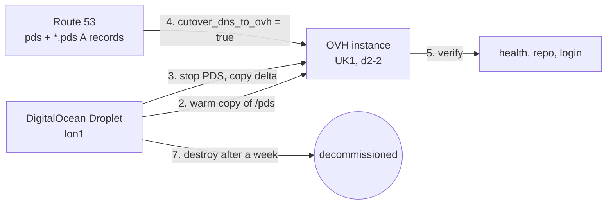

# Migrating the PDS from DigitalOcean to OVH

Moves the PDS from a DigitalOcean Droplet in `lon1` to an OVH Public Cloud `d2-2` instance in
`UK1`, with no data loss and around ten minutes of downtime.

## Approach

This is a lift and shift of the `/pds` directory, not an AT Protocol account migration.

Everything the PDS owns lives under `/pds`: `pds.env` (which holds the JWT secret, the admin
password and the PLC rotation key), `account.sqlite`, `sequencer.sqlite`, `did_cache.sqlite`, the
per-actor SQLite repos under `actors/`, the blobstore under `blocks/`, and the Caddy TLS
certificates under `caddy/`.

Copy that directory byte for byte onto a new host serving the same hostname and the DID document
never changes. No PLC operation is needed, the handle stays resolvable, and the firehose sequence
continues from where it left off. The only thing that changes is the IP address behind
`pds.<your root domain>`.

Carrying `caddy/` across also carries the existing certificates, so Caddy does not need to complete
an ACME challenge at the moment of cutover.



## Before you start

1. Create an OVH Public Cloud project, and note its ID. This is also the OpenStack tenant ID.
2. Create OVH API credentials at <https://api.ovh.com/createToken/> with unlimited rights on `/cloud/*`.
   This gives you an application key, application secret and consumer key.
3. In the OVH control panel under **Public Cloud > Users & Roles**, create a user with the
   `administrator` role and download its `openrc` file. This gives you the OpenStack username and
   password.
4. Add the new variables to your `.auto.tfvars`:

   ```hcl
   ovh_project_id         = "..."
   ovh_application_key    = "..."
   ovh_application_secret = "..."
   ovh_consumer_key       = "..."
   openstack_user_name    = "..."
   openstack_password     = "..."
   ssh_public_key         = "ssh-ed25519 AAAA... you@example.com"
   backup_bucket_name     = "..." # must be unique within the region
   ```

Leave `cutover_dns_to_ovh` at its default of `false`. While it is `false`, DNS keeps pointing at the
Droplet, so every step up to the cutover is safe to apply.

## Procedure

### 1. Provision the OVH instance and backup bucket

```shell
terraform init -upgrade
terraform apply
```

This creates the instance, its security group, the backup bucket and a bucket-scoped user, and
leaves DNS pointing at DigitalOcean. Note the new IP:

```shell
terraform output server_ip
```

### 2. Install a bare PDS on the new instance

The OVH Ubuntu images log in as `ubuntu`, not `root`.

```shell
ssh ubuntu@$(terraform output -raw server_ip)
sudo bash -c 'wget https://raw.githubusercontent.com/bluesky-social/pds/main/installer.sh && bash installer.sh'
```

Give the installer the same domain as the existing PDS. The secrets it generates are thrown away in
step 4, but running it is what installs Docker, the `pds` systemd unit and `pdsadmin`.

Stop it once the install finishes, so nothing is writing to `/pds` while you copy into it:

```shell
sudo systemctl stop pds
```

### 3. Warm copy, while the old PDS is still serving

This moves the bulk of the data with no downtime. Repeat it as often as you like; each run only
transfers what changed.

```shell
sudo rsync -aHAX --rsync-path='sudo rsync' \
  root@pds.<your root domain>:/pds/ /pds/
```

### 4. Cut over

Downtime starts here. Stop the old PDS first, so the two instances never serve the same repo at
once — running both would fork the firehose sequence.

```shell
# on your machine
ssh root@pds.<your root domain> 'systemctl stop pds'

# on the OVH instance
sudo rsync -aHAX --delete --rsync-path='sudo rsync' \
  root@pds.<your root domain>:/pds/ /pds/
```

Point DNS at the new instance by setting `cutover_dns_to_ovh = true` in your `.auto.tfvars`, then:

```shell
terraform apply
```

The records have a 300 second TTL. Wait for it to expire, then start the new PDS:

```shell
ssh ubuntu@$(terraform output -raw server_ip) 'sudo systemctl start pds'
```

### 5. Verify

```shell
curl https://pds.<your root domain>/xrpc/_health
curl "https://pds.<your root domain>/xrpc/com.atproto.repo.describeRepo?repo=<your DID>"
curl https://plc.directory/<your DID>
```

The `describeRepo` call should return your handle and collections. The PLC entry should be
unchanged, still pointing at the same hostname — if it changed, something went wrong and you should
stop and investigate rather than continue.

Then log in from the Bluesky app and post.

### 6. Set up backups

See [Backups](#backups) below. Do this before decommissioning the Droplet, so you are never running
without one.

### 7. Decommission DigitalOcean

Wait about a week, and confirm backups are landing in the bucket, before you do this. Until the
Droplet is destroyed it remains a complete, bootable rollback.

Power the Droplet off first and run for a few days on OVH alone. Then remove the following from the
repository and apply:

- `module "pds_droplet"` and `output "droplet_ip"`
- the `digitalocean` provider and its `required_providers` entry
- the `digitalocean_token`, `digitalocean_ssh_key_id` and `droplet_region` variables
- the `cutover_dns_to_ovh` variable, replacing its use in `module "pds_dns"` with
  `module.pds_instance.ip_address`
- the `./modules/droplet` directory

Each of these is marked with a `TODO` referencing this document.

## Backups

The OVH instance has no managed snapshot workflow, by choice. The backup is a copy of `/pds` in OVH
Object Storage, which is also what you would restore from onto a fresh host — the same procedure you
just rehearsed above.

Terraform has already created the bucket and a user scoped to it alone. Install the credentials on
the instance:

```shell
terraform output -raw backup_access_key_id
terraform output -raw backup_secret_access_key
```

These are deliberately not injected via cloud-init, because instance metadata is readable by
anything running on the box and is stored by OVH. Write them out over SSH instead:

```shell
sudo install -m 600 /dev/null /root/.pds-backup.env
sudo tee /root/.pds-backup.env >/dev/null <<'EOF'
export AWS_ACCESS_KEY_ID=...
export AWS_SECRET_ACCESS_KEY=...
export AWS_DEFAULT_REGION=uk
export BACKUP_ENDPOINT=https://s3.uk.io.cloud.ovh.net
export BACKUP_BUCKET=...
EOF
```

### Why not rsync the SQLite files directly

`blocks/`, `caddy/`, `pds.env` and `compose.yaml` are safe to copy while the PDS runs. The SQLite
databases are not — they run in WAL mode, and copying an open one can produce a torn file that only
fails when you try to restore it. Use the SQLite online backup API for those, which is safe against
a live writer.

`sqlite3` is already installed; the PDS installer requires it.

```shell
sudo tee /usr/local/bin/pds-backup >/dev/null <<'EOF'
#!/usr/bin/env bash
set -euo pipefail

. /root/.pds-backup.env

STAGE=/var/backups/pds
mkdir -p "$STAGE"

find /pds -name '*.sqlite' -print0 | while IFS= read -r -d '' db; do
  dest="$STAGE/${db#/pds/}"
  mkdir -p "$(dirname "$dest")"
  sqlite3 "$db" ".backup '$dest'"
done

rsync -a --delete --exclude '*.sqlite*' /pds/ "$STAGE/"

aws s3 sync "$STAGE/" "s3://$BACKUP_BUCKET/pds/" \
  --endpoint-url "$BACKUP_ENDPOINT" --delete
EOF
sudo chmod 700 /usr/local/bin/pds-backup
```

Then schedule it, for example nightly at 03:00:

```shell
echo '0 3 * * * root /usr/local/bin/pds-backup' | sudo tee /etc/cron.d/pds-backup
```

Run it once by hand and confirm objects appear in the bucket before relying on it.

### Restoring

Follow steps 1, 2 and 4 of the procedure above, replacing the `rsync` with an `aws s3 sync` in the
opposite direction, onto a stopped PDS.

## Notes

- **`d2-2` is OVH's Discovery range.** It is best effort with no SLA and cannot be resized into
  another family. `b3-8` is the general purpose equivalent if that becomes a problem.
- **An OVH instance with no security group of its own falls back to a permissive `default` group**
  that allows everything in both directions. The `instance-ovh` module is what closes the box, so do
  not detach it.
- **`pds.env` contains the PLC rotation key.** Anywhere it is copied to needs to be treated as
  secret. Losing the key means you can never update your DID document; leaking it means someone else
  can. The backup bucket is encrypted at rest and reachable only by its own scoped user.
